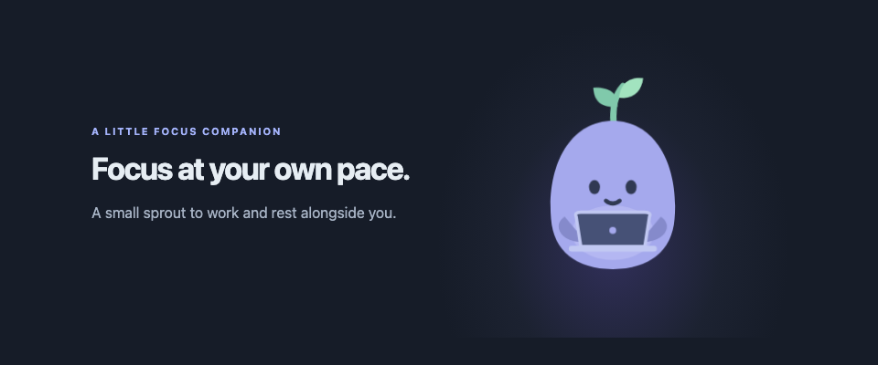
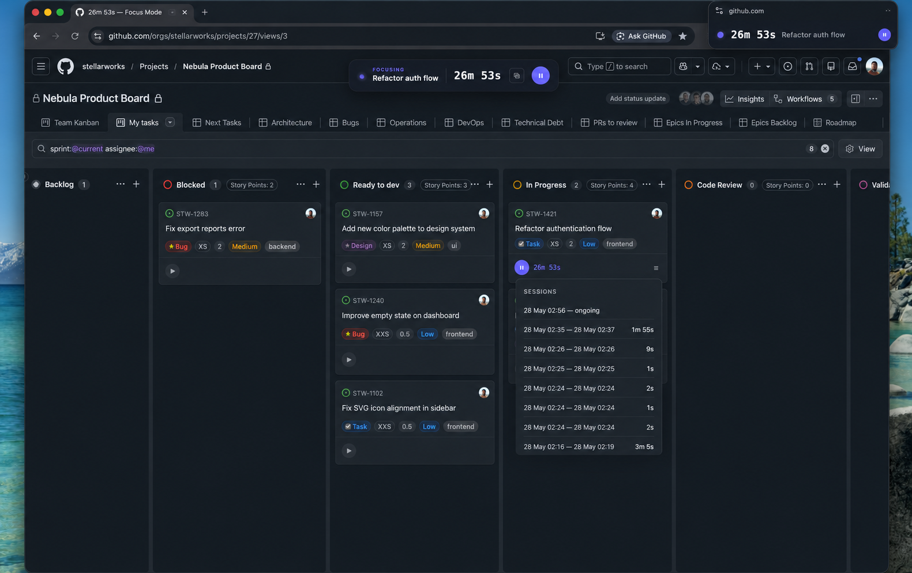

# GitHub Issues Time Tracker

Track time and stay focused on one issue at a time, directly from your GitHub Projects board.



Your sprout companion works alongside you in Picture-in-Picture and rests when you pause.



## Installation

Requires Chrome 116+ and a GitHub Projects v2 board on `github.com`. The extension is not yet available in the Chrome Web Store:

1. Clone or download this repository.
2. Open `chrome://extensions` and enable **Developer mode**.
3. Click **Load unpacked** and select the repository root.

## Using the timer

Each board card has a play/pause button and a time display. Only one timer can run at a time; starting another pauses the previous one. The indicator is grey before any time is recorded, green when paused and indigo while running. Start and stop actions play a short sound.

Hover over the card timer and click **☰** to see its sessions, or **🎉** for a confetti celebration. While running, the floating bar shows the issue, elapsed time and controls; the browser tab title and extension badge also show the timer.

The **Ancla de propósito** is a short personal note above the GitHub issue title. Add or edit it from the card's lower action row; the editor opens on a second line below the timer controls. On a card's first timer start, an optional prompt appears without delaying the timer. The note stays local to that board card and appears in the floating bar, PiP and popup history.

Open the extension popup to stop the active timer, browse daily history by issue and access **Settings**.

### Picture-in-Picture

Click **⧉** in the floating bar to open an always-on-top window with the sprout, timer, issue and pause/resume button. Chrome may limit the requested window size; opening it requires a user gesture.

When configured, the window also shows:

- **Workday progress:** elapsed scheduled work time, excluding breaks. Colored segments show work intervals; the white marker shows the current time.
- **Focus progress:** today's recorded focus against your daily goal. Hover for hours, goal and any enabled pace comparison.

Pausing stops focus time but not workday progress. Percentages refresh every second. Animations respect the system's reduced-motion preference.

## Settings

Open **Settings** from the extension popup. Changes save automatically; switching sections does not disable features.

### General

- **Open PiP when starting a timer:** open PiP when starting from a card.
- **Keep PiP open when paused:** keep progress visible and resume from PiP. It does not reopen a window closed manually.

Both options are off by default.

### Workday

- **Daily focus goal:** opt in to show focus progress in PiP. The default goal is 2 hours, configurable and the same every day. All recorded focus counts, including time outside work hours; sessions crossing midnight contribute only today's portion.
- **Work schedule:** set local work intervals and breaks for each day. **Copy Monday to all other days** replaces Tuesday through Sunday, including weekends; adjust individual days afterwards. Split overnight shifts across days.

Daily and weekly totals exclude breaks. Without a schedule for the current day, the workday bar and pace comparison are unavailable, but focus progress still appears. The focus-bar sweep is based on [CSS Loaders' progress example 16](https://css-loaders.com/progress/#l16).

### Pace

Pace compares recorded focus with the daily goal spread evenly across scheduled work hours. The white marker shows the expected pace; when paused, green means on track or ahead and amber means behind. While focusing, the focus bar remains green.

The **on track or ahead** and **behind** indicators can be enabled separately; both default to on. Disabling an indicator hides its marker, details and comparison color, without disabling reminders.

**Visual reminder** and **Sound reminder** are independent and off by default. Both require an open PiP, a paused timer, an enabled focus goal behind schedule, and current time within work hours.

- The visual reminder pulses the background amber along with the sprout and focus percentage. With reduced motion, the background remains steadily amber.
- The sound reminder plays two short bursts and the sprout briefly reacts. Its interval defaults to **2 minutes** and accepts whole minutes of at least 1; saved intervals are unchanged. The first alert occurs after the interval and repeats while conditions hold.

Changing the interval restarts the wait. Resuming focus, getting back on pace, disabling sound or entering a break resets it; closing PiP stops reminders. Sleep or browser throttling may delay alerts.

## Data and limitations

Sessions and Ancla de propósito notes are stored in the GitHub domain's `localStorage` under `gitt:<boardCardId>`, with start/end timestamps and issue information. Running state and totals are derived from those sessions. The notes never update GitHub issues. Clearing browser data erases tracked time and notes.

Preferences are stored separately in `chrome.storage.local`. Neither sessions nor preferences sync across devices or Chrome profiles.

- Multiple GitHub Projects tabs may have conflicting active timer state.
- The extension depends on GitHub's Projects markup; GitHub changes may break its selectors.

## Development

The selector tests require a local GitHub Projects fixture:

1. Open a Projects board in Chrome and open DevTools → **Elements**.
2. Right-click `<html>` → **Copy** → **Copy outerHTML**.
3. Save it as `tests/fixtures/board.html`. The fixture is git-ignored; refresh it if GitHub's markup changes.
4. Install dependencies and run the tests:

   ```sh
   npm install
   npm test
   ```

## Ideas for the future

- Track time directly on issue and pull request pages.
- Add a meeting timer to the popup.
